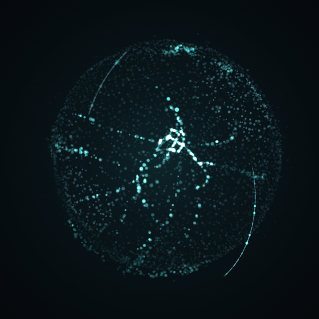
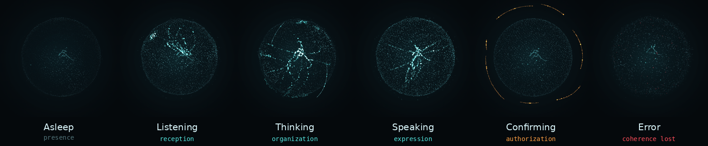
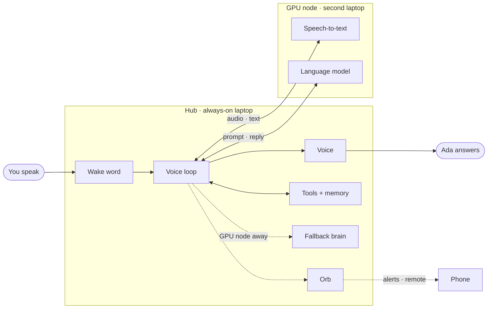

<div align="center">



# A.D.A

**Agentic Dialogue Assistant**

A personal voice assistant that listens, thinks and acts.<br>
Private, local, and built with security at its core.


</div>

---

## Meet Ada

You say her name, talk normally, and she answers out loud. She can set reminders, take notes, look things up and wake you in the morning, and she never changes anything without your "yes".

Everything runs on your own devices: an always-on laptop at home, a gaming laptop for the heavy lifting, and your phone. No subscription, no cloud model, and no audio ever leaves your own machines.

| | |
| --- | --- |
| **Voice-first** | Wake her with a phrase, speak naturally, interrupt her when you need to. |
| **Local** | Speech, language model and memory all run on your own machines. |
| **Agentic** | She uses tools to get things done, not just to chat. |
| **Secure by design** | Safety rules are enforced in code, not left to the model's judgement. |

## Her face

Ada shows what she is doing through a living particle orb. Each state is a different way information moves through her: inward while she listens, back and forth while she thinks, outward while she speaks.

<p align="center"></p>

Orange appears only when she is waiting for your approval, red only when something has failed. Open [`hud/orb.html`](hud/orb.html) in a browser to see it live; keys `1`–`6` switch state.

On the desktop the orb lives in a small always-on-top pop-up in a corner of the screen. It appears when you say her name and fades out when the conversation ends. Click it to open the full dashboard.

## How she works



The **Hub** listens for her name, manages the conversation and speaks the reply. The **GPU node** turns speech into text and runs the language model. Your **phone** receives alarms and works as a remote.

The GPU node is also a laptop that leaves the house. Before each request the Hub checks whether it is reachable. If it is not, Ada answers with a smaller model on the Hub's own CPU, and the orb's core dims slightly to show it. Reminders and alarms never depend on the GPU node.

All devices are connected over Tailscale. Nothing is exposed to the internet and no router ports are opened.

<details>
<summary><b>The stack</b></summary>

| Part | Choice |
| --- | --- |
| Wake word | openWakeWord |
| Voice activity, turn taking | Silero VAD, Smart Turn |
| Voice loop | Pipecat |
| Speech-to-text | faster-whisper (`distil-large-v3`, English) |
| Language model | Ollama with `qwen3:8b` on the GPU node |
| Fallback brain | `qwen3:4b` / `qwen3:1.7b` on the Hub's CPU |
| Text-to-speech | Kokoro |
| Tools | FastMCP, strict allowlist |
| Memory | SQLite + Chroma |
| Scheduler | APScheduler |
| HUD | FastAPI, WebSocket, Three.js |
| Desktop orb | pywebview pop-up, pystray tray icon |
| Phone alerts | self-hosted ntfy |
| Network | Tailscale between all devices |

Every choice and the reason behind it: [docs/decisions.md](docs/decisions.md) · Full architecture: [docs/architecture.md](docs/architecture.md)

</details>

## Security

Ada is built with an attacker's mindset. The model proposes; the code decides.

- She can only use tools on an **allowlist**. No shell, no payments, no sending messages.
- Anything that changes something **waits for your confirmation**. Silence means no.
- Web pages and notes are treated as **data, never as instructions**.
- Every tool call goes into an **append-only audit log**.
- Nothing is exposed to the internet.

This public repository is guarded too: a gitleaks pre-commit hook, a CI secret scan and GitHub push protection keep keys, phone numbers and personal data out of git.

Threat model and full rules: [docs/security.md](docs/security.md) · Reporting a vulnerability: [SECURITY.md](SECURITY.md)

## Roadmap

- [ ] **Phase 0 · Setup** — repository, guardrails, machines talking *(in progress)*
- [ ] **Phase 1 · Parts** — each component proven on its own
- [ ] **Phase 2 · First words** — wake, listen, think, answer out loud; fallback brain
- [ ] **Phase 3 · Face** — the orb follows Ada's real state; desktop pop-up and dashboard
- [ ] **Phase 4 · Hands** — tools, confirmation and audit log
- [ ] **Phase 5 · Memory** — remembers what you tell her, forgets on request
- [ ] **Phase 6 · Her name** — custom wake phrase, natural interruptions
- [ ] **Phase 7 · Reach** — phone alarms and remote
- [ ] **Phase 8 · v1** — hardening, prompt-injection defense, release

Later: French, calendar and email, Arabic, vision.

<details>
<summary><b>Getting started</b></summary>

Requirements: Git, [uv](https://docs.astral.sh/uv/) (it installs Python 3.12 for you), and [Ollama](https://ollama.com) on the GPU node.

```bash
git clone https://github.com/Givemeboga/A.D.A.git
cd A.D.A

# Python 3.12 environment
uv venv --python 3.12

# turn on the guardrails before your first commit
uv tool install pre-commit
pre-commit install

# your private config (ignored by git; on Windows use "copy")
cp config/config.example.toml config/config.local.toml
# set gpu_node.host to the GPU node's LAN or Tailscale address

# on the GPU node
ollama pull qwen3:8b

# Phase 0 check, from the Hub
uv run python tests/smoke/check_ollama.py
```

</details>

<details>
<summary><b>Repository layout</b></summary>

```
hub/          voice loop, tools, memory, HUD server
gpu-node/     speech-to-text service
hud/          the orb and, later, the dashboard
tools/        tool servers
config/       example config (committed) · local config (ignored)
docs/         architecture, decisions, security
tests/smoke/  one check per component
```

</details>

---

<div align="center">
<sub>Named after Ada Lovelace. Built by <a href="https://github.com/Givemeboga">Gl1tch</a>. MIT licensed.</sub>
</div>
